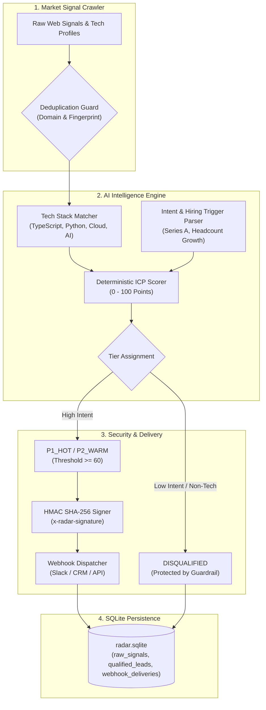

# 📡 RadarAI — Autonomous Web Intelligence & Lead Pipeline

[](https://www.typescriptlang.org/)
[](https://zod.dev/)
[](https://vitest.dev/)
[](https://en.wikipedia.org/wiki/HMAC)
[](https://github.com/WiseLibs/better-sqlite3)
[](LICENSE)

An enterprise-grade autonomous web intelligence and lead qualification pipeline. Designed to ingest raw market signals, evaluate tech stack synergy and expansion triggers using deterministic AI enrichment models, and deliver signed webhooks (`x-radar-signature`) to downstream CRMs (HubSpot, Salesforce, Slack) with automated spam prevention guardrails.

---

## 🏛️ Pipeline Architecture



---

## ⚡ Technical Capabilities

1. **Schema Contracts with Zod:** Guarantees strict runtime typing across raw signals, enriched leads, and outgoing webhook payloads.
2. **Deterministic ICP Qualification:** Evaluates headcount, hiring triggers, modern tech stacks, and high-value B2B industries with zero hallucination risk.
3. **Dispatch Guardrail:** Blocks unqualified or low-priority leads from triggering downstream API webhooks, eliminating webhook flood and spam.
4. **Cryptographic HMAC Signing:** All webhook dispatches generate an `x-radar-signature` header via SHA256 HMAC for client-side tamper verification.
5. **Relational Audit Trail:** Tracks raw signals, qualification scores, and delivery HTTP status codes inside an embedded SQLite database.

---

## 🚀 Quickstart

### Prerequisites
* **Node.js:** `>= 20.0.0`
* **npm:** `>= 10.0.0`

### 1. Installation & Build
```bash
# Clone the repository
git clone https://github.com/Alemarpapa/radar-lead-pipeline.git
cd radar-lead-pipeline

# Install dependencies
npm install

# Compile TypeScript
npm run build
```

### 2. Run the Interactive Live Demo
```bash
npm run demo
```
Ingests mock market signals, scores high-intent FinTech companies vs disqualified local shops, applies webhook security guardrails, and renders SQLite audit tables.

### 3. Run Automated Tests
```bash
npm test
```

---

## 📁 Repository Structure

```
├── data/                    # SQLite database storage (radar.sqlite)
├── src/
│   ├── schemas/
│   │   └── lead.ts          # Zod contracts for signals, leads, and webhooks
│   ├── pipeline/
│   │   ├── enricher.ts      # Deterministic AI lead qualification engine
│   │   └── dispatcher.ts    # Webhook delivery with HMAC-SHA256 signing
│   ├── db.ts                # SQLite database transactions & schema
│   └── demo.ts              # End-to-end interactive demo
├── tests/
│   └── radar.test.ts        # Vitest automated test suite
├── package.json             # Scripts and dependencies
├── tsconfig.json            # Strict TypeScript configuration
└── README.md                # Enterprise documentation
```

---

## 👤 Author
**Alejandro** — AI-Augmented Developer & Automation Engineer  
*Specialized in Autonomous Pipelines, MCP Servers, and Enterprise Guardrails.*

## 📄 License
MIT
